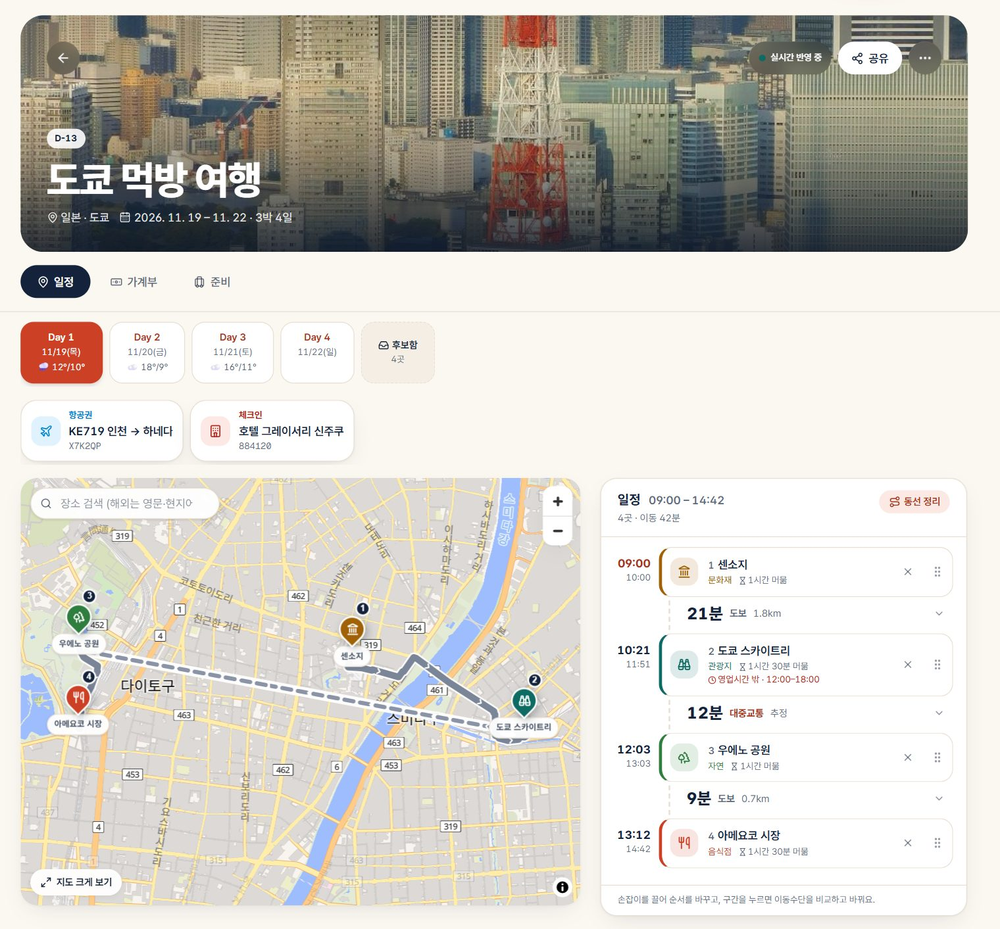

# Triplan

[English](README.md) | **한국어**

가고 싶은 곳을 모아 두었다가, 여행이 정해지면 지도 위에서 하루씩 계획하고, 링크 하나로 동행자와 함께 편집하는 여행 플래너입니다.

데모: https://triplan-beryl.vercel.app



## 이렇게 씁니다

**1. 모으기.** 언젠가 가 보고 싶은 나라·도시를 우선순위·메모와 함께 세계지도에 저장합니다. 마음이 정해지면 버튼 하나로 여행이 됩니다.

**2. 계획하기.**
- 장소를 검색하거나 지도를 눌러 Day마다 핀을 꽂습니다. 끌어서 순서를 바꾸고, **동선 정리**로 이동 거리가 짧은 순서로 줄 세웁니다.
- 날을 못 정한 곳은 **후보함**에 두고, 걸어서 다닐 만한 구역으로 묶어 Day에 통째로 옮깁니다. **AI 추천**으로 관심사에 맞는 장소를 받아 (지도에서 위치를 확인한 것만) 후보함에 담을 수도 있습니다.
- **전체** 탭에서 모든 Day를 Day 색으로 한 지도에 보고, 밤마다 **숙소**를 정하면 다음 날은 숙소에서 출발하고 그날은 숙소로 돌아오는 길까지 이어집니다.
- 장소를 열면 사진·설명(위키백과)과 전화·웹사이트·주소(OpenStreetMap)가 나오고, 일정 목록에는 사진 썸네일이 붙습니다.
- 구간마다 실제 길을 따라 경로를 그리고 대중교통·도보·택시를 비교합니다.
- 하루 일정은 도착·출발 시각이 붙은 타임테이블이 되고, 휴무일이나 영업시간 밖에 도착하면 알려 줍니다.

**3. 준비하기.**
- 템플릿이 있는 준비물 체크리스트와 항공·숙소·티켓 예약을 기록합니다. 예약 확인 메일을 붙여 넣으면 AI가 칸을 채워 줍니다. 예약은 그날 일정 위에 뜹니다.
- 날씨 예보, 시차·콘센트·긴급 전화 같은 현지 정보를 봅니다.
- 일정을 캘린더로 구독하거나 일정표로 인쇄하고, 구글 내 지도용 지도 파일(.kml)로 받습니다.

**4. 함께하기.**
- 동행자에게는 **편집 링크**, 가족에게는 **보기 링크**를 보냅니다. 회원가입은 필요 없습니다.
- 누가 고치면 모두의 화면에 바로 반영되고, 지금 누가 보고 있는지와 변경 기록이 남습니다.
- 장소마다 **가고 싶어요**와 댓글을 남겨 후보함을 함께 고릅니다.
- 가계부에 현지 통화로 적으면 원화로 바꿔 모으고, 동행자 정산(송금 횟수 최소)과 예산을 계산합니다.

**5. 여행 중, 그리고 다녀와서.**
- 여행 중에는 오늘 일정과 다음 장소가 먼저 보이고, 길찾기는 카카오맵·구글 지도로 이어집니다. 한 번 연 여행은 오프라인에서도 보입니다.
- 다녀온 뒤에는 하루 일기와 장소 별점을 남기고, 회고 카드 이미지와 여권 도장 모음(`/archive`)으로 돌아봅니다.

한국어·영어, 기본 통화, 라이트·다크 모드를 지원하고 홈 화면에 앱으로 설치할 수 있습니다(PWA).

## 권한

| 누가 | 어떻게 | 할 수 있는 일 |
|---|---|---|
| 관리자 | `ADMIN_PASSWORD`로 로그인 | 전부 (모든 여행, 회원 관리) |
| 사용 회원 | 관리자가 만든 아이디로 로그인 | 내 여행, 다른 회원 초대 |
| 편집 링크 `/t/<token>` | 링크만 있으면 | 그 여행 하나 편집 |
| 보기 링크 `/v/<token>` | 링크만 있으면 | 그 여행 하나 보기 (예약번호 숨김) |
| 체험 회원 | 관리자가 만든 아이디로 로그인 | 공개로 표시한 여행만 보기 |

링크는 언제든 새로 발급할 수 있고, 그러면 이전 링크는 바로 막힙니다. 권한은 모든 API가 서버에서 검사합니다([`src/lib/auth.ts`](src/lib/auth.ts)).

## 로컬에서 실행

```bash
# 1. Postgres를 띄우고 마이그레이션을 순서대로 적용
docker run -d --name triplan-pg -e POSTGRES_PASSWORD=triplan -e POSTGRES_DB=triplan -p 5433:5432 postgres:16-alpine
for f in supabase/migrations/*.sql; do docker exec -i triplan-pg psql -U postgres -d triplan < "$f"; done

# 2. 앱 실행 (http://localhost:3000 에서 ADMIN_PASSWORD로 로그인)
npm install
cp .env.example .env.local
npm run dev
```

검사: `npm run lint`, `npm test`(계산 로직 자체 점검), `npm run build`.

### 환경 변수

필수는 `DATABASE_URL`, `ADMIN_PASSWORD`, `SESSION_SECRET`(32자 이상 무작위 문자열) 세 개입니다. 나머지는 없어도 동작하고, 넣으면 기능이 좋아집니다.

| 변수 | 넣으면 |
|---|---|
| `KAKAO_REST_KEY` | 국내 장소 검색 |
| `ODSAY_API_KEY` | 한국 대중교통 경로 (없으면 추정 시간) |
| `NVIDIA_API_KEY` | 후보함 구역 이름(없으면 동네 이름), AI 장소 추천, 예약 메일 읽기 (NVIDIA NIM) |
| `MYMEMORY_EMAIL` | 지도 라벨 번역 한도를 하루 5천 자에서 5만 자로 |
| `EXCHANGE_RATE_API_KEY` | 키가 있는 환율 API (없으면 키 없는 무료 엔드포인트) |
| `NEXT_PUBLIC_MAPBOX_TOKEN` | MapLibre 대신 Mapbox 지도 |
| `SITE_URL` | 공유 링크 미리보기 이미지의 주소 기준 (예: `https://triplan-beryl.vercel.app`) |
| `SAMPLE_TRIP_PATH` | 소개 화면에 "샘플 여행 둘러보기" 버튼 (예: `/v/abc123`) |

## 배포

앱과 Postgres가 Oracle Cloud VM 한 대에서 돌고, 앞에서 Caddy가 TLS를 맡습니다. `main`에 push하면 [CI](.github/workflows/ci-cd.yml)가 lint·테스트·빌드 뒤 VM에서 [`deploy/deploy.sh`](deploy/deploy.sh)를 실행하고, `/api/health`가 실패하면 이전 릴리스로 되돌립니다.

- **새 마이그레이션은 VM에서 직접 적용해야 합니다.** `deploy.sh`는 마이그레이션을 실행하지 않습니다.
- 비밀값은 VM의 `~/triplan/.env`에 둡니다. GitHub secrets는 `VM_HOST`, `VM_SSH_KEY`, `VM_KNOWN_HOSTS`입니다.
- `triplan-beryl.vercel.app`은 VM으로 넘기는 프록시일 뿐입니다([`deploy/vercel/vercel.json`](deploy/vercel/vercel.json)). 다시 배포할 때는 `deploy/vercel` 폴더에서 하세요. 저장소 루트에서 `vercel deploy`를 하면 프록시가 DB 없는 빌드로 덮어써집니다.

## 기술 스택

Next.js 16 (App Router) · React 19 · TypeScript · Tailwind CSS 4 · PostgreSQL 17 · MapLibre + OpenFreeMap. 경로는 Valhalla와 ODsay, 영업시간은 OpenStreetMap(Overpass), 번역은 MyMemory, 날씨는 Open-Meteo를 씁니다.

## 출처

나라·도시 사진은 Wikimedia Commons 이미지입니다([`public/backgrounds/CREDITS.md`](public/backgrounds/CREDITS.md)). 지도 데이터 © OpenStreetMap 기여자, 타일 OpenFreeMap.
