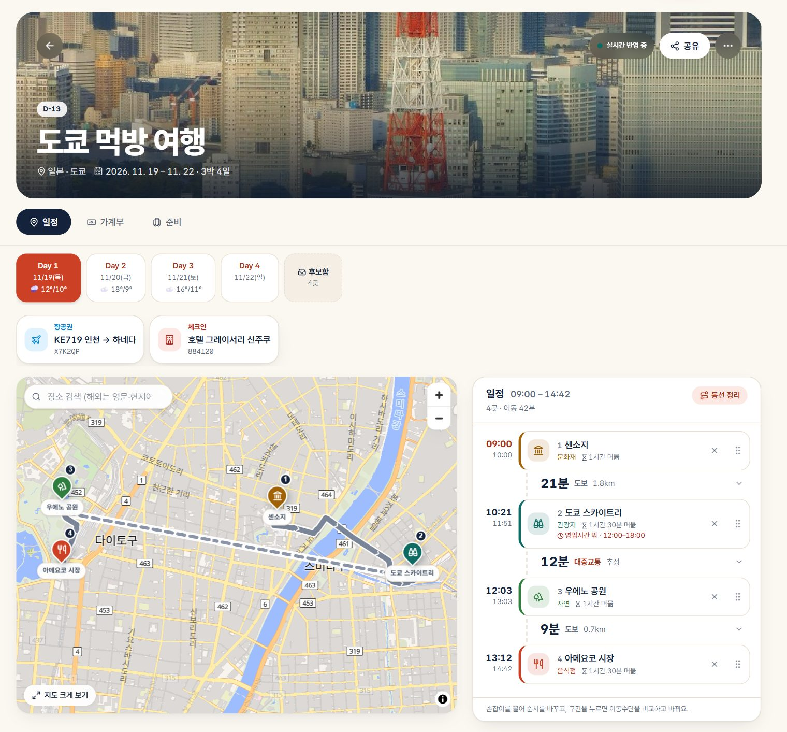

# Triplan

**English** | [한국어](README.ko.md)

A travel planner for collecting the places you want to go, planning a trip day by day on a map once it's decided, and editing it together with companions through a single link.

Demo: https://triplan-beryl.vercel.app



## How it works

**1. Collect.** Save countries and cities you want to visit someday on a world map, with a priority and notes. When you're ready, one button turns a place into a trip.

**2. Plan.**
- Search for places or tap the map to pin them to each day. Drag to reorder, or let **Optimize route** order them by travel distance.
- Keep undecided places in the **Maybe** list, group them into walkable areas, and move a whole area to a day. **AI ideas** suggests places for your interests and only offers the ones found on the map.
- The **All** tab shows every day on one map in day colors. Set a **stay** for each night and the next day starts from it, with the way back added at the end of the day.
- Opening a place shows a photo and summary (Wikipedia) and phone, website and address (OpenStreetMap); plan rows get photo thumbnails.
- Each leg is drawn along real streets, and you can compare transit, walking and taxi.
- Each day becomes a timetable with arrival and departure times, and it warns you when you'd arrive on a closed day or outside opening hours.

**3. Prepare.**
- Keep a packing checklist with templates, and record flight, hotel and ticket bookings (paste a confirmation email and AI fills the form). Bookings show up on top of that day's plan.
- See the weather forecast and local info such as time difference, plugs and emergency numbers.
- Subscribe to the plan as a calendar, print it as an itinerary, or download a map file (.kml) for Google My Maps.

**4. Share.**
- Send companions an **edit link** and family a **view link**. No sign-up needed.
- Edits show up on everyone's screen right away, along with who's viewing now and a change history.
- Companions mark places they **want to go** and comment, so the Maybe list becomes a shared shortlist.
- Log expenses in local currency to get KRW totals, the fewest transfers to settle up, and a budget.

**5. On the trip, and after.**
- During the trip, today's plan and the next stop come first, with directions in Kakao Map or Google Maps. Trips you've opened once stay readable offline.
- Afterwards, keep a daily journal and place ratings, make a recap card image, and collect passport stamps at `/archive`.

Korean and English, a home currency, and light and dark themes are supported, and the app can be installed to the home screen (PWA).

## Access

| Who | How | Can do |
|---|---|---|
| Admin | Log in with `ADMIN_PASSWORD` | Everything (all trips, members) |
| Member | Log in with an ID the admin created | Own trips, invite other members |
| Edit link `/t/<token>` | Anyone with the link | Edit that one trip |
| View link `/v/<token>` | Anyone with the link | Read that one trip (booking codes hidden) |
| Demo member | Log in with an ID the admin created | Read only trips marked as public |

Links can be reissued at any time, which blocks the old one immediately. Every API checks access on the server ([`src/lib/auth.ts`](src/lib/auth.ts)).

## Run locally

```bash
# 1. Start Postgres and apply the migrations in order
docker run -d --name triplan-pg -e POSTGRES_PASSWORD=triplan -e POSTGRES_DB=triplan -p 5433:5432 postgres:16-alpine
for f in supabase/migrations/*.sql; do docker exec -i triplan-pg psql -U postgres -d triplan < "$f"; done

# 2. Run the app (log in at http://localhost:3000 with ADMIN_PASSWORD)
npm install
cp .env.example .env.local
npm run dev
```

Checks: `npm run lint`, `npm test` (self-checks for the calculation logic), `npm run build`.

### Environment variables

Only `DATABASE_URL`, `ADMIN_PASSWORD` and `SESSION_SECRET` (32+ random characters) are required. The app works without the rest; each one turns something on or improves it.

| Variable | Adds |
|---|---|
| `KAKAO_REST_KEY` | Place search in Korea |
| `ODSAY_API_KEY` | Korean transit routes (otherwise an estimate) |
| `NVIDIA_API_KEY` | NVIDIA NIM: area names in the Maybe list (otherwise neighbourhood names), AI place ideas, reading booking emails |
| `MYMEMORY_EMAIL` | Raises the map-label translation quota from 5,000 to 50,000 characters a day |
| `EXCHANGE_RATE_API_KEY` | A keyed exchange-rate API (otherwise a free keyless endpoint) |
| `NEXT_PUBLIC_MAPBOX_TOKEN` | Mapbox instead of MapLibre |
| `SITE_URL` | Base URL for share-link preview images, e.g. `https://triplan-beryl.vercel.app` |
| `SAMPLE_TRIP_PATH` | A "Browse a sample trip" button on the landing page, e.g. `/v/abc123` |

## Deploy

The app and Postgres run on one Oracle Cloud VM, with Caddy in front for TLS. A push to `main` runs [CI](.github/workflows/ci-cd.yml): lint, tests and build, then [`deploy/deploy.sh`](deploy/deploy.sh) on the VM. If `/api/health` fails, it rolls back to the previous release.

- **Apply new migrations on the VM yourself.** `deploy.sh` does not run them.
- Secrets live in `~/triplan/.env` on the VM. The GitHub secrets are `VM_HOST`, `VM_SSH_KEY` and `VM_KNOWN_HOSTS`.
- `triplan-beryl.vercel.app` is only a proxy to the VM ([`deploy/vercel/vercel.json`](deploy/vercel/vercel.json)). Redeploy it from `deploy/vercel`. Running `vercel deploy` from the repo root replaces the proxy with a build that has no database.

## Tech stack

Next.js 16 (App Router) · React 19 · TypeScript · Tailwind CSS 4 · PostgreSQL 17 · MapLibre + OpenFreeMap. Routes come from Valhalla and ODsay, opening hours from OpenStreetMap (Overpass), translations from MyMemory, and weather from Open-Meteo.

## Credits

Country and city photos are from Wikimedia Commons ([`public/backgrounds/CREDITS.md`](public/backgrounds/CREDITS.md)). Map data © OpenStreetMap contributors, tiles by OpenFreeMap.
