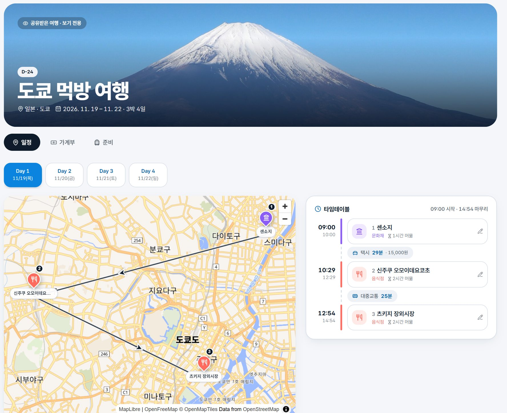

# Triplan

**English** | [한국어](README.ko.md)

A travel planner that starts from the places you dream about. Save places you want to visit someday on a world map, turn one into a trip when you are ready, plan it day by day on a map with a timetable, budget, and packing list, and share it with one link so companions can edit along with you.

- Demo: https://triplan-beryl.vercel.app



## Features

| Feature | Description |
|---|---|
| Wishlist | Save countries and cities you want to visit with a priority, memo, and tags. Pins on a world map. Turn any of them into a trip in one tap |
| Day-by-day map | Search places (Kakao for Korea, OSM Photon worldwide) or tap the map or a POI icon to drop pins. The map opens at the city you picked, and the route is drawn as a line with direction arrows |
| Visit order | Stops appear as chips joined by arrows (① → ② → ③). Drag a chip to reorder, tap it to open details |
| Place details | Pick an icon (sight, restaurant, cafe, shopping, heritage, nature, stay, transport) and pin color, and attach photos, a link, and a memo to each stop |
| Timetable | Set arrival time and stay length per stop and travel mode and minutes per leg; the day becomes a timetable with arrival and departure times |
| Korean map labels | Labels with no Korean name in OpenStreetMap (shops, facilities, streets) are machine-translated to Korean as you move the map. A place picked from the map gets its Korean name beside the local one: `東京タワー (도쿄 타워)` |
| Budget | Record expenses in local currency with automatic KRW conversion and per-day and per-category summaries. Amount input with comma formatting and quick-add buttons |
| Packing and bookings | Checklist with templates, plus flight, hotel, and ticket records with D-day badges |
| Trip journal | Once a trip starts, a **Record** tab adds a daily journal with weather and mood, star ratings and one-line reviews for each stop, and trip stats (places, distance, spending). Finished trips open on this tab |
| Archive | `/archive` collects a passport stamp for every finished trip, a map of places visited and still wished for, and every stop you rated |
| Share links | Each trip has an **edit link** for companions and a **view link** for family and friends. No sign-up. Booking codes are hidden on view links |
| Travel-app UI | Photo-first cards, bottom tab bar on mobile, bottom sheets, page and list motion, D-day count-up, installable as a PWA |

## Access Model

There is no sign-up. One admin password protects everything, each trip carries two random tokens, and the admin creates member accounts (user or demo).

| Who | How | Can do |
|---|---|---|
| Admin | Logs in with only `ADMIN_PASSWORD` (HMAC-signed cookie). The only admin | Everything: all trips, own wishlist, share links, members, delete |
| User account | Logs in with an ID and password the admin created on the Members page | Own trips and wishlist. Invites other users to a trip by ID; invited users edit it after logging in. Only the owner (or admin) manages links, invites, and deletion |
| Edit link `/t/<token>` | Opens the link | Edit that one trip's pins, plan, budget, checklist, bookings |
| View link `/v/<token>` | Opens the link | Read that one trip. Booking codes and links are removed by the API |
| Demo account | Logs in with an ID and password the admin created on the Members page | Read trips the admin marked "Show to demo accounts" in the share sheet. No place search, translation, or exchange rates |

Links can be regenerated at any time, which immediately disables the old one. Changes appear on everyone's open trip page within about a second (Postgres `NOTIFY` → Server-Sent Events), or every few seconds by polling if a proxy blocks the stream. Every API route checks access on the server ([`src/lib/auth.ts`](src/lib/auth.ts)).

## How Korean Labels Work

1. When the map stops moving, the app collects the visible labels that have no `name:ko`.
2. It sends them in batches to `/api/translate`, guessing the source language from kana or the trip's country.
3. The server answers from a shared cache table (`triplan.name_translations`) and asks the free [MyMemory](https://mymemory.translated.net/) API only for names it has not seen.
4. The answers are swapped into the map's label expression, so an area you have seen once shows in Korean right away.

The free limit is about 5,000 characters a day, or 50,000 with `MYMEMORY_EMAIL` set. When it runs out, labels stay in the local language. Translations are machine-made, so names can be off; place names are editable.

## Tech Stack

- Next.js 16 (App Router), React 19, TypeScript, Tailwind CSS 4, framer-motion
- PostgreSQL 17 via `pg` (tables in the `triplan` schema), self-hosted on an Oracle Cloud VM
- MapLibre with the OpenFreeMap Liberty style (restaurant, cafe, sight, and station icons; Carto as fallback, Mapbox with a token), dnd-kit, date-fns
- MyMemory translation API (free, no key)

## Getting Started

### 1. Database

Apply the files in [`supabase/migrations/`](supabase/migrations) in order to any Postgres 13+. The app role must own the `triplan` tables: RLS is enabled with no policies, so only the owner can read them. Only the Next.js server talks to the database.

For local development you can use any Postgres instead:

```bash
docker run -d --name triplan-pg -e POSTGRES_PASSWORD=triplan -e POSTGRES_DB=triplan -p 5433:5432 postgres:16-alpine
for f in supabase/migrations/*.sql; do docker exec -i triplan-pg psql -U postgres -d triplan < "$f"; done
```

### 2. App

```bash
npm install
cp .env.example .env.local
npm run dev
```

Open http://localhost:3000 and log in with `ADMIN_PASSWORD`.

| Variable | Required | Purpose |
|---|---|---|
| `DATABASE_URL` | Yes | Postgres connection string |
| `ADMIN_PASSWORD` | Yes | Admin login |
| `SESSION_SECRET` | Yes | Signs the login cookie (32+ random characters) |
| `KAKAO_REST_KEY` | No | Place search in Korea |
| `NEXT_PUBLIC_MAPBOX_TOKEN` | No | Use Mapbox instead of MapLibre |
| `MYMEMORY_EMAIL` | No | Raises the free translation limit |
| `EXCHANGE_RATE_API_KEY` | No | Exchange rates (a free endpoint is used without it) |

### 3. Deploy (Oracle Cloud VM)

The app and the database run on the same VM. Postgres is reachable only on `127.0.0.1`, and Caddy terminates TLS in front of the app.

| Piece | Where |
|---|---|
| App | `node server.js` (standalone build) as systemd [`triplan.service`](deploy/triplan.service) on `127.0.0.1:8030` |
| Secrets | `~/triplan/.env` on the VM (same variables as the table above) |
| Database | Local PostgreSQL 17, `postgres` database, `triplan` schema owned by the `triplan` role |
| CI/CD | [`.github/workflows/ci-cd.yml`](.github/workflows/ci-cd.yml): lint and build on every push and PR. On `main`, SSH into the VM and run [`deploy/deploy.sh`](deploy/deploy.sh), which builds, swaps the release, and rolls back if `/api/health` fails |

GitHub secrets: `VM_HOST`, `VM_SSH_KEY` (a key limited to `deploy.sh` with `command=` in `authorized_keys`), and `VM_KNOWN_HOSTS`.

`triplan-beryl.vercel.app` is only a proxy: [`deploy/vercel/vercel.json`](deploy/vercel/vercel.json) rewrites every path to the VM. Redeploy it from that folder (`cd deploy/vercel && vercel link --project triplan && vercel deploy --prod`). Running `vercel deploy` at the repository root would replace the proxy with a standalone Vercel build that has no database.

## Project Structure

```
src/
├── app/
│   ├── (admin)/         Admin-only pages: wishlist, new trip, trip workspace
│   ├── t/[token]/       Edit link
│   ├── v/[token]/       View link
│   ├── login/           Admin login
│   └── api/             Route handlers (all access-checked)
├── features/
│   ├── home/            Landing and dashboard
│   ├── wishlist/        Wishlist map, cards, form
│   ├── trip/            Trip workspace, place details, share panel
│   ├── map/             Map engine wrapper, pins, route arrows, Korean labels
│   ├── route/           Day tabs, visit order chips, timetable
│   ├── expenses/        Budget
│   ├── prep/            Checklist and booking records
│   ├── shell/           App shell (top bar, bottom tab bar)
│   └── ui/              Cover photo, bottom sheet, money input, date helpers
├── lib/                 DB pool, auth, translation, API client, types
└── data/                Countries, cities, map centers, background photos
supabase/migrations/     Database schema
```

## Credits

Country and city photos are from Wikimedia Commons (city photos via `scripts/fetch-city-photos.mjs`). See [`public/backgrounds/CREDITS.md`](public/backgrounds/CREDITS.md). Map data © OpenStreetMap contributors, tiles by OpenFreeMap.
